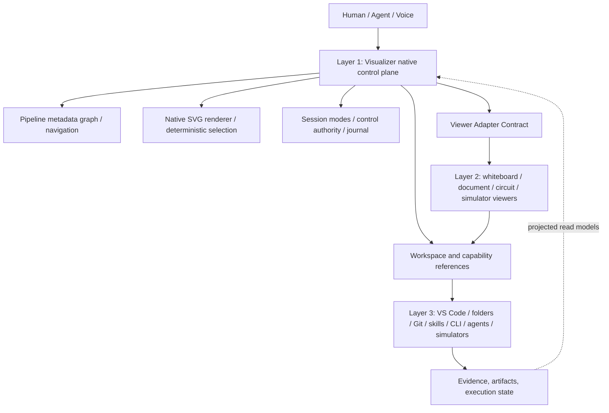
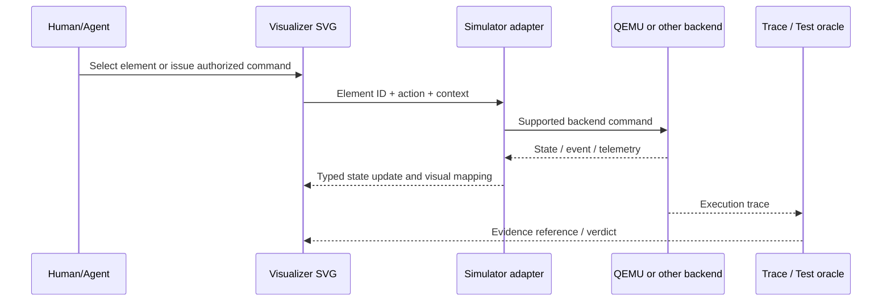

# COP Visualizer — Comprehensive Architect Blueprint and Context Package
**Baseline:** CV-ARCH-0.1 · **Date:** 2026-11-26 · **Author role:** COP Master Architect (handoff synthesis) · **Recipient:** Dhriti · **Authority:** Govi, Product Owner
**Status:** STAGED FOR EXPLICIT INGESTION. Conceptual architecture and design proposals; NOT a verified implementation baseline, approved coding specification, or APP checkpoint.

## 0. Read this first — authority, boundaries and evidence
This document captures the architectural reasoning from the November COP Visualizer discussion, not just a summary. It is a project-specific architectural briefing. It does not replace Dhriti's role, identity, canonical APP checkpoint, or protocol. It is deliberately separated from the Spec-to-Simulator canonical memory. PO direction: work on Visualizer first, preserve Spec-to-Simulator for later, treat simulation as a possible reusable Visualizer plugin; MissionLoop is deferred.
**Evidence legend:** [PO] stated direction; [ARCH] architect recommendation requiring review; [REPORTED] existing behavior described conversationally but not inspected in the Visualizer repository; [VERIFY] discovery needed; [DEFER] not phase-one.
**Authority:** Govi approves scope, accepted decisions, implementation and releases. Dhriti reconciles architecture; Codex provides evidence and implements only under a separately approved brief; Dhruv may coordinate. LiveLoop communicates but is not an authoritative artifact store.
**Immediate workflow:** (1) resume Dhriti using APP; (2) Govi explicitly asks to ingest intake/visualizer.md; (3) load this blueprint and prior relevant canonical concepts; (4) request read-only Codex discovery; (5) reconcile and propose an approval-ready design; (6) only then implementation.

## 1. Problem, objectives, non-goals
[PO] Visualizer Light exists; preserve working capabilities and evolve it into a horizontal COP visual access/control plane for agents and humans. Users should inspect pipelines, select artifacts and SVG elements, navigate collaboratively, ask agents to explain or make authorized changes, and view simulator outputs through adapters.
[ARCH] Design principles: metadata-first; skill-driven; evidence-driven; tool reuse; explicit ownership; artifact-agnostic; pluggable; human interruptibility; local-first initial scope; honest capability reporting.
**Not:** a replacement VS Code, file explorer, document editor, simulator engine, pipeline scheduler, Git repository, or universal UI automation system. **Not:** a new APP runtime. Avoid duplicate sources of truth.

## 2. Three-layer architecture

**Layer 1 owned by COP:** pipeline/stage projection, native SVG elements and identity, deterministic click selection, navigation, highlighting, visual state, journal/replay, browser dashboard, modes, session authority, adapter registry. Native SVG editing belongs here; do not push it to third-party whiteboards.
**Layer 2 adapters:** external Markdown/PDF/Office viewers, Excalidraw/tldraw/Freero-like whiteboards, circuit/CAD tools, simulation visualization and traces. Plugins declare read/select/edit/animate/subscribe capabilities and limitations. Do not claim unsupported editing.
**Layer 3 authoritative workspace:** real files and generated artifacts, Git, project folders, VS Code, Pipeline Management skill, Codex/Claude/Copilot, document generation, QEMU/other simulators and test harnesses. No hidden duplication of artifacts in Visualizer SQLite.

## 3. Conceptual data model and truth ownership
Entities [ARCH]: Project, PipelineDefinition, PipelineRun, Stage, StageDependency, ArtifactRef, ViewerInstance, VisualElementRef, Selection, Session, Actor, ControlLease, Mode, Annotation, Action, EvidenceRef, VisualRevision, Checkpoint. IDs stable and scoped; use explicit source/version for each projected value.
Relationships: Project has pipelines; pipeline has stages; stages link to 0..N artifact references; one artifact may serve N stages; a viewer displays a reference; selection targets a viewer element; evidence links stage/run/action; actions are authorized by session/lease and logged. A stage need not map one-to-one to a file or folder.
**Truth table:**
- Pipeline order, dependency, run state, approvals → Pipeline Management skill / run records.
- Artifact bytes and versions → filesystem/Git/producing tool.
- Simulator state and measurements → simulator/harness/trace recorder.
- SVG presentation state, selection, layout, visual journal → Visualizer native store.
- Identity/checkpoints of Dhriti → APP canonical home; never Visualizer SQLite.
- Conversation/notifications → LiveLoop transport, with durable decisions written to the proper authority.
Use SQLite transactionally for local Visualizer metadata; JSON manifests for portable definitions; reconcile projections using source IDs and timestamps/revisions. Do not assume network-safe multi-writer SQLite or encrypted storage.

## 4. Pipeline visual projection
A pipeline stage starts as a blank node; its card can later show linked artifacts, status, owner, evidence and next actions. The graph supports sequential, parallel, feedback and adaptive stages. Folder structure may mirror pipeline but must not encode authoritative dependencies. An illustrative SDLC pipeline: requirements → analysis → architecture/design → test preparation → test execution → evidence/reporting, with issue feedback to earlier stages. Adaptive subloops may explore multiple options within a stable top-level milestone. Render status from the pipeline owner, not inferred solely from folder existence. Support alternative versions and links without copying artifact bytes.

## 5. Interaction, skills and authority
Separate **skill** (available action vocabulary), **session mode** (what interaction is happening), and **control authority** (who may navigate/edit/approve).
Modes [ARCH]:
| Mode | Navigation | Explanation | Modification |
| --- | --- | --- | --- |
| Present | Prepared playback | Scripted or guided | No |
| Walk & Talk | Agent/human guided; interruptible | Yes | No |
| Walk & Design | Guided, pause/resume | Yes | Only after authorization |
| Co-View | Shared inspection | Yes | No |
| Co-Think | Exploratory canvas | Yes | Working hypotheses, not approved artifacts |
| Co-Design | Collaborative | Yes | Authorized edits |
Control must be visibly attributable; human may interrupt/reclaim. No surprise edits during presentation. Store presentation cursor and resume point. Voice is an interface; it is not itself edit authorization. Visualizer skill controls native element actions, voice skill narrates, interaction coordination selects mode. [DEFER] complex gestures, multi-selection, speculative inference from hand motions.
**Example:** "Explain this circuit" selects a native SVG component, highlights current path, narrates. If behavior is illustrative, label it. If claiming electrical or temporal accuracy, link to validated model/simulation evidence.

## 6. Native SVG, plugin viewers, and simulator tile
[REPORTED] Visualizer Light already supports browser-served SVG, deterministic element identity/click selection, an agent/API path for edits, SQLite visual persistence and revision/journal/checkpoint/replay, master dashboard tiles and early Brainstorm tab. [VERIFY] Codex must inspect exact source paths, tests and browser behavior.
[ARCH] A simulator environment may appear as a tile/node. Example: **QEMU is an execution backend**, while an SVG device/panel is its visualization. SVG is not the emulator; the adapter connects commands, observed state, events and traces. The visual element-to-simulator mapping must be explicit, versioned and reversible where possible.

**Simulator adapter contract (proposed):** identify backend and version; declare capabilities; initialize/attach/detach; list state channels; map visual element IDs to backend signals; subscribe to state/events; issue authorized commands with correlation ID; report latency/health/error; provide trace and evidence references; distinguish mock/replay/model/emulation/real hardware and confidence. QEMU may require target-specific monitor/QMP, guest agent, instrumentation or serial interfaces; **do not assume arbitrary SVG ↔ QEMU control is available without an adapter**.
For a simulator tile, stage metadata may point to backend session, SVG panel asset, control mapping and trace stream; backend process remains Layer 3, plugin is Layer 2, tile and selection are Layer 1.
[ARCH] Future integration with Spec-to-Simulator: representative spec → scenario/test criteria → simulator backend → trace/harness verdict → Visualizer evidence-backed observation. A mock UI is allowed, but never equate mock animations with validated simulator behavior.

## 7. Viewer plugin capability contract (proposed)
```json
{
  "adapter_id": "example.viewer",
  "version": "0.1",
  "media_types": ["image/svg+xml"],
  "capabilities": {
    "view": true, "navigate": true, "select": true,
    "edit": false, "annotate": false, "animate": false,
    "subscribe_state": false, "execute_command": false
  },
  "authority": "read-only",
  "evidence_semantics": "illustrative"
}
```
Adapters should expose a stable viewer instance, source reference, selected element reference, command schema, and error model. Require capability checks before offering a command. Structured APIs preferred; computer-use fallback is explicitly less reliable and must be verified. External Office/PDF/CAD editing is not phase-one acceptance.

## 8. Co-Think / Brainstorm
Co-Think is an always-available collaboration capability, not a setup wizard. Exploratory alternatives, diagrams, notes and experiments may be persisted as **working** material. Promotion into a formal deliverable requires explicit attribution/decision. Co-Design differs by permitting authorized artifact edits; Co-View is non-editing. Potential whiteboard engines: React Flow/xyflow for graph UI; Excalidraw for freeform; tldraw subject to production license; Freero as another candidate. [VERIFY] compatibility, licensing, integration cost and performance. No dependency approved, no 50–80% reuse claim accepted as measured.

## 9. Lifecycle and user journeys
**Journey A — project setup:** user/agent discuss objective and pipeline; Pipeline Management defines stages and approvals; workspace scaffolds folders if separately authorized; Visualizer projects blank stages; artifacts later appear as links.
**Journey B — Walk & Talk:** agent opens pipeline, highlights stage, shows selected SVG, narrates via voice; user interrupts; agent answers; navigation resumes without altering design.
**Journey C — Walk & Design:** user requests change; system checks capability/authority; captures proposed delta and scope; human authorizes; edit executed via native API or appropriate plugin; journal/evidence updated; walkthrough resumes.
**Journey D — simulator tile:** attach backend, show SVG panel, subscribe to state, trigger approved scenario, record trace, display observed result and qualification; loss of backend must be visible, not simulated silently.
**Journey E — Co-Think:** explore alternate assembly concepts, compare evidence, optionally promote a selected concept to a stage deliverable.

## 10. Safety, reliability, provenance and acceptance
Every action should identify actor, scope, target, requested/observed outcome, correlation ID, source revision and permission. Do not equate agent narration with authoritative truth. Prefer deterministic selection and typed commands. Recover gracefully from stale references, unavailable plugins, lost backend connection, browser reload and partial edits. Preserve journal integrity and clear audit semantics. Do not allow plugins to silently bypass approval gates. Security/permissions and multi-PC concurrency need dedicated design; single PC/one human/multiple agents is initial scenario.
**Initial architecture acceptance [proposed]:** existing Visualizer Light functions remain intact; pipeline projection reads but does not mutate pipeline truth; one native SVG selected element is addressable by agent; one plugin can declare limited capabilities; one walkthrough is interruptible; simulator tile design cleanly separates view/backend/evidence; source-linked decisions and tests are recorded. Exact measurable thresholds after Codex discovery.

## 11. Codex read-only discovery brief
Inspect repository, branch/commit, dependencies, entrypoints, frontend, SQLite schema, visualizer skill, dashboard, SVG selection/element mapping/API, journal/checkpoints, Brainstorm tab, browser and VS Code integration, voice/computer-use, pipeline-management skill and manifests, security, tests, actual host evidence. For each capability classify Implemented/Partial/Absent/Unverified and cite file/line/test. Identify interface seams and backward-compatibility constraints; assess plugin candidates/licenses without installing. Return component map, API inventory, data schema, evidence matrix, architectural gaps, minimal non-destructive POC candidates and open questions. **No edits, installs, migration, release, push or field-network changes.**

## 12. Architecture decisions ledger
| ID | Statement | Classification |
| --- | --- | --- |
| V01 | Visualizer is a horizontal metadata/control plane, not workspace | [PO] baseline |
| V02 | Three-layer architecture and native SVG in Layer 1 | [PO]/[ARCH] baseline |
| V03 | Pipeline manager owns workflow truth | [ARCH] recommended boundary |
| V04 | Preserve Visualizer Light and deterministic selection | [PO] requirement |
| V05 | Co-Think persistent, not setup-only | [PO] requirement |
| V06 | Modes separate from authority and skills | [ARCH] design |
| V07 | External viewer engines reused through adapters | [PO]/[ARCH] direction |
| V08 | Simulation backend represented by tile/SVG via adapter | [PO] concept |
| V09 | No implementation before discovery and PO approval | [PO] governance |
| V10 | Dhriti Visualizer first, Spec-to-Simulator retained | [PO] priority |
| V11 | APP remains unchanged; staged intake only until skill ingestion | [PO] safety |

## 13. Open questions / architectural tradeoffs
Which existing Visualizer API is stable? Which source owns pipeline run state and artifact links? Is SVG edit transactional? Does journal support multi-agent concurrency? Which voice/computer-use actions are real vs planned? What simulator instrumentation and state channels are available for QEMU? What latency and fidelity are required? How will plugins authenticate and enforce authority? How to reconcile browser sessions with SQLite and LiveLoop? Which whiteboard license and UI reuse are viable? Which POC best validates plugin and element mapping without disturbing the field environment? Dhriti should answer using code/evidence, not guesses.

## 14. Dhriti context-loading and APP preservation
**Existing home:** GovindarajD/dhriti-architect-spec-to-simu; agent ID dhriti; branch main; APP protocol 0.2.0 candidate, checkpoint schema 0.1.0. Existing AGENTS.md and manifests/app.json govern resume. The protocol repository is not a runtime dependency; do not change it. Existing APP-001 through APP-005 checkpoints and role remain immutable. Current APP-005 may still focus on host qualification: **this staged assignment does not silently supersede that focus**. Govi explicitly activates Visualizer intake only after Dhriti has resumed.
On activation, Dhriti must load this blueprint with source attribution and omission list, review prior relevant Spec-to-Simulator concepts, and use the installed APP skill to create a valid child checkpoint with manifest/integrity, stale-head protection and remote readback. If host lacks the skill, permissions or qualification, report BLOCKED/LIMITED and keep the staged files intact. Do not manually edit APP canonical records or claim successful publication without verification.
**Bootstrap phrase:** "Dhriti, resume your existing APP identity first. Then ingest intake/visualizer.md and its linked architect blueprint, preserving Spec-to-Simulator context. Report what was loaded, omitted and verified. Do not implement yet."
**Handoff limitation:** this document transfers explicit architectural thinking, not hidden model identity, runtime state, or unrecorded reasoning.

## 15. Architect deliverables after discovery
A. Current-vs-target capability matrix with file/line evidence.
B. Updated logical/component/deployment diagrams and plugin boundaries.
C. Data ownership, state, authorization, and API contracts.
D. Proposed simulator SVG adapter proof (QEMU only if instrumentation is demonstrably available).
E. Reuse/licensing assessment and backward compatibility plan.
F. Risk/decision ledger with PO approval questions.
G. Phase-one POC design and objective acceptance tests, not code until approved.

**End of staged blueprint.**
